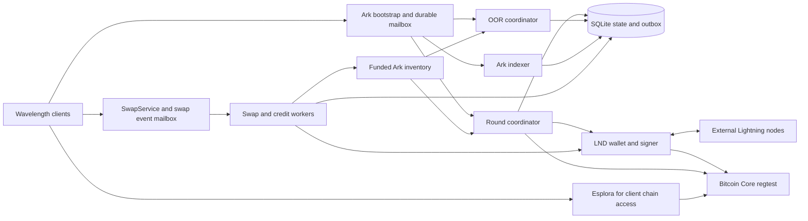

# wl-regtest-server implementation plan

## Objective and agreed scope

Build a standalone Go server, distributed as a Docker image, that implements
the operator and swap services needed for **regtest validation of Wavelength
integrations**. It connects to Bitcoin Core and an LND node with pre-funded
on-chain and channel balances. Clients use the public Wavelength implementation
with its normal transaction, signature, invoice, and recovery validation enabled.

The server must support:

- On-chain boarding, including the wallet's automatic boarding path.
- Lightning onboarding into an initially empty wallet.
- Sending and receiving Lightning payments with external nodes.
- Invoice payments between two users of the same Wavelength operator.
- Credits: small receives, Ark top-ups, credit-only payments, mixed
  credit/VTXO payments, credit-assisted receives, and redemption into VTXOs.
- VTXO refresh, collaborative exit, and unilateral exit with the server offline.
- Observable failure, refund, retry, reconnect, and restart behavior.

Ordinary Loop clients, Loop In/Out RPC compatibility, production deployment,
Taproot Assets, commercial liquidity pricing, cross-product batching, and
transaction cut-through are outside scope. Loop is a source of reusable public
components and swap patterns, not an additional service to implement.

Use small rounds, straightforward coin selection, one Lightning backend, and
explicit state machines. Simplify scheduling and economics while retaining real
funding, signatures, timelocks, forfeits, preimages, and chain settlement.

This document records the original implementation design. The delivered package
layout and verification results are recorded in [validation.md](validation.md);
reproducible operating instructions are in [the README](../README.md).

## Compatibility baseline and research

Research date: **2026-09-06**. The target is latest upstream Wavelength, pinned
for reproducible builds. The freshly fetched upstream `main` resolves to
[`f7cc57a0042ec2e2106035fe0f2f5e6590967f8a`][wave-pin]. Refresh the pin at the start
of implementation and review protocol changes explicitly; never build against
an unrecorded moving branch.

The consuming integration currently uses a public client fork. Comparing it
with this upstream commit found identical Ark, indexer, round, OOR, and swap
protocol definitions, and identical swap SDK sources. Remaining integration
differences include SQLite wallet storage, startup expiry classification, and
the high-level wallet refresh API. Track these as client integration work;
they do not justify a fork-specific server protocol. Prefer merged upstream
changes. If they remain unmerged, adapt the validation client to upstream or
use a clearly recorded temporary compatibility patch for those client features.

The public source establishes several consequential design requirements:

| Finding | Consequence | Public source |
| --- | --- | --- |
| Ark bootstrap is direct RPC; rounds and OOR use RPC over durable mailboxes. | Implement the mailbox edge, routing, asynchronous events, and replay semantics. | [Ark RPC][ark-proto], [round protocol][round-proto], [mailbox protocol][mailbox-proto] |
| Clients query an operator indexer for VTXOs and finalized OOR artifacts. | A balance map or an Esplora server cannot replace the Ark indexer. | [Indexer RPC][indexer-proto] |
| Lightning receives use client-signed invoices with a virtual final channel. | Use LND's forwarding interceptor and preserve the final-hop onion for client validation. | [Receive SDK][out-swap], [invoice creation][invoice], [LND Router RPC][lnd-router] |
| The receiver signs an acknowledgement before server funding. | Persist and validate the event, wait for acknowledgement, then fund the vHTLC. | [Swap RPC][swap-proto], [acknowledgement digest][swap-ack] |
| Same-operator invoice payments have a dedicated settlement type. | Implement `IN_ARK` settlement using a genuine vHTLC. | [Swap RPC][swap-proto], [pay SDK][in-swap] |
| The public libraries construct and validate signed transaction trees and OOR packages. | Reuse them, adding authoritative UTXO/VTXO state checks around the validators. | [Tree library][tree], [OOR transaction library][oor-tx] |
| Credits have authenticated, server-authoritative balances and operations. | Implement actual funding and reservations; return consistent operation history. | [Credit protocol][swap-proto], [credit client][credit] |
| Recovery requires complete signed ancestry, package fees, and timelock maturity. | Prove unilateral exit early, and retain recovery artifacts throughout every flow. | [Unroll][unroll], [recovery planner][unrollplan] |

Source code and generated contracts take precedence over older narrative docs.
For example, a description of funding before notification must not override
the current acknowledgement-before-funding RPC contract.

The planning investigation passed the existing tests in all 13 selected upstream
packages: `lib/arkscript`, `lib/tree`, `lib/tx`, its four subpackages, `swaprpc`,
`serverconn`, `indexer`, `rpc/roundpb`, `rpc/oorpb`, and `sdk/swaps`. The swap SDK's
HTTP tests required local socket access. The tests ran against the pinned upstream
source with Go 1.27.3, read-only module resolution, and cached dependencies.
These establish useful library baselines, not end-to-end server compatibility.
Real Docker interoperability remains an implementation acceptance requirement.

## Architecture

One process implements both server roles. Keep their identities and state
separate: the Ark operator key, swap participant keys, per-round tree signing
keys, sweep keys, and forfeit keys have different protocol roles even though
one binary coordinates them.

Proposed package boundaries:

| Package | Responsibility |
| --- | --- |
| `cmd/wl-regtest-server` | Configuration, startup, shutdown, and health command. |
| `internal/server` | Service wiring, gRPC listeners, dependency readiness. |
| `internal/store` | SQLite migrations, transactions, durable jobs and outbox. |
| `internal/mailbox` | Authenticated mailbox edge, RPC dispatch, push events. |
| `internal/ark` | Round coordination, OOR admission/signing, funded inventory. |
| `internal/indexer` | Proof-authorized script queries, ancestry, event history. |
| `internal/swaps` | Receive intents, invoice payments, vHTLC settlement/refunds. |
| `internal/credits` | Credit funding, reservations, debits, redemption. |
| `internal/lnd` | Wallet, signer, payment, invoice, and interceptor adapters. |
| `internal/chain` | Bitcoin RPC, confirmations, spends, package submission. |
| `internal/testcontrol` | Optional regtest fault controls and state inspection. |
| `itest` | Public Wavelength client integration tests and Docker harness. |

Use narrow interfaces and ordinary owned workers. The public actor framework is
available, but the server need not reproduce the client's actor architecture.
Every worker has a daemon-owned context, bounded operations, cancellation, and a
shutdown wait. Inject the clock for wall-clock deadlines; obtain block heights
from the chain backend.

Use upstream Go modules rather than copying client code. Pin the root Wavelength
module and its separate `baselib` module to compatible public revisions. Preserve
necessary remote module replacements explicitly: dependency `replace` directives
and `go.work` files do not propagate to consumers. The inspected client uses the
btcsuite `/v2` module family; avoid mixing its transaction types with older Loop
types. Reuse [Loop's FSM package][loop-fsm] where useful. Its conventional
[HTLC scripts][loop-htlc] are not Wavelength's six-leaf vHTLC policies.

## Wire services and behavior

Use the upstream generated Go service definitions and mailbox registration
helpers. Keep field numbers, message types, status codes, and version negotiation
compatible. Implement only Bitcoin policies, and reject unsupported versions
or asset requests explicitly.

| Surface | Required implementation |
| --- | --- |
| `arkrpc.ArkService` | `GetInfo`, `EstimateFee`; real operator key, regtest network, current height, version selection, limits and fee terms. |
| `mailbox.v1.MailboxService` | `Send`, `Pull`, `AckUpTo`. |
| `round.v1.RoundService` | `JoinRound`, quote acceptance/rejection, nonce and partial-signature submissions, boarding signatures, VTXO forfeits, status queries. |
| `oorpb.OORMailboxService` | `SubmitPackage`, `FinalizePackage`, including typed rejection details. |
| `arkrpc.IndexerService` | All eight currently defined methods: registration/list/unregister, recipient events, VTXO inventory, OOR sessions, subtrees, and VTXO change feed. |
| `swaprpc.SwapService` | All ten currently defined methods, including credits, acknowledgement, refund authorization, and both vHTLC refresh-signing methods. |

The Ark and swap endpoint settings may point to separate listeners in the same
container. Both expose the mailbox facilities needed by their respective client
connections. Start with Go gRPC consumers; an HTTP/REST gateway is not required
for the initial mobile Go integration.

Keep mailbox transport version, negotiated Ark version, and per-round/per-OOR
flow version separate. Import the upstream constants rather than inferring
numeric values from names: at this pin both `FlowVersionV1` constants are zero,
despite a stale round protobuf comment describing one.

### Mailboxes and authentication

Persist ingress before acknowledging `Send`. Deduplicate semantic requests by
authenticated principal, method, and idempotency identity; retain a payload
digest to reject conflicting reuse. Keep transport message IDs, RPC correlation
IDs, and semantic operation IDs distinct.

Dispatch using the upstream mailbox router. Persist state changes and outgoing
responses/events together. Preserve `reply_to`, correlation, protobuf `Any` type,
and negotiated Ark version. A handler's RPC acknowledgement and later push event
are different messages; `QueryRoundStatus`, for example, returns its actual
status asynchronously.

Implement bounded long polling, ordered per-mailbox event sequences, exclusive
acknowledgement watermarks, and replay after reconnect. An acknowledgement at
cursor `N` permits removing events strictly below `N`. Preserve operation results
longer than transport delivery records so a delayed retry cannot execute twice.

Use the public [mailbox authentication helpers][mailbox-auth] and canonical
mailbox-ID derivation. Verify sender ownership, recipient authorization, and
Pull/Ack metadata, including swap mailboxes derived from identity and payment
hash. Plaintext regtest transport does not waive application signatures. TLS
mode additionally honors the client's certificate-binding protocol; plaintext
is an explicit local test configuration.

### On-chain boarding and rounds

1. Verify the join request's [intent-bound BIP-322 authorization][bip322], its
   selected version, and each referenced input. Check boarding outputs against
   Bitcoin Core for script, amount, confirmations, and spend status. Bind VTXO
   inputs to stored policy, amount, lineage, and current spend eligibility.
2. Reserve the inputs, produce a concrete quote, and wait for explicit acceptance.
   Support fixed outputs, change, and sweep-all semantics exercised by the client.
   Reject/expire an unaccepted quote without making its inputs permanently busy.
3. Construct a real commitment transaction with the public tree builders. The
   LND wallet contributes liquidity and miner fees. Use the smallest valid tree
   and connector construction, with no wait for unrelated participants.
4. Freeze the funding transaction before tree signing. Supply the exact
   `ClientBatchInfo`, including per-round cosigning, connector, sweep and forfeit
   keys, absolute expiry terms, PSBT metadata, and extracted tree paths.
5. Exchange and verify MuSig2 nonces and partial signatures; aggregate the full
   tree signatures. Only then collect the required connector-bound VTXO forfeits
   and boarding-input signatures in the order the client FSM expects.
6. Persist the complete signed transaction, trees, forfeits and response outbox
   before broadcasting. Announce committed/confirmed states from actual chain
   observations. Do not label a broadcast as a confirmation.
7. Publish authoritative indexer data and wake-up events. Client balances become
   spendable through the real protocol and confirmation path.

Handle one-client rounds first, but allow several inputs and outputs. Subsequent
coverage must include two simultaneous clients, joins while another round is
signing, and leave-only rounds. A valid operator-owned leaf may keep a minimal
tree present when a construction requires one; never invent a user output.

The initial pricing policy can charge zero service margin and subsidize miner
fees from the funded LND wallet. `EstimateFee`, accepted quotes, and final output
amounts must still agree. Add configurable fixed fees to exercise fee limits;
do not reproduce utilization pricing or capital-cost optimization.

### Ark liquidity and OOR transfers

A funded LND wallet is not itself an Ark balance. Create a real operator-funded
commitment and swap-owned VTXOs before advertising receive liquidity. Maintain
this inventory using the same tree, round, OOR, and signing code used for client
operations, with separate swap participant keys. Persist replenishment jobs and
wait for the required confirmation. The test harness controls mining.

For OOR submission, verify canonical ordering, value conservation, policy
bindings, input ownership, known live prevouts, and the client signature material
required at that stage. Reserve each input to exactly one session. Attach the
operator signatures and persist the exact resulting artifacts before returning
them. Finalization must match that transcript byte for byte and pass the public
signature/script validators before publishing spend and receive events.

The public validators do not replace authoritative state checks. In particular,
structural validation alone does not prove that a checkpoint spends a live VTXO
or that its policy is acceptable. Validate each complete spend with the script
VM and bind tree roots to the actual commitment outputs.

**Releasing a checkpoint signature is an irreversible protocol step.** A timeout
after that point must not unlock the old VTXO for a conflicting session. Resume
the existing transcript or resolve it through the recovery rules.

Preserve the full signed tree/OOR/checkpoint ancestry and policy templates for
every output. Implement ordinary transfers, change, multiple inputs, vHTLC
funding, claims, and refunds through this one engine. OOR operations should not
require a new block after funded inventory exists.

### Indexer

Use the same transactionally updated VTXO/session records as the Ark engine.
Support pagination and monotonic event cursors, offline catch-up, script
registration notifications, exact outpoint lookup, spent-output metadata, signed
subtrees, and complete finalized OOR packages.

Validate the client's canonical Schnorr query proofs, their request bindings and
expiry. A vHTLC has a NUMS internal key: authorize its relevant policy participant
keys instead of requiring impossible key-path ownership. Both parties must be
able to observe the applicable funding and spend artifacts without a prior
ordinary receive-script registration.

Expose claim witnesses/preimages through finalized artifacts. The pay client
checks the revealed preimage against the payment hash; a server-generated
"payment complete" flag cannot substitute for this evidence.

### External Lightning payments

Terminology follows Wavelength: an **in-swap** sends Ark value to Lightning; an
**out-swap** receives Lightning value into Ark.

For an in-swap:

1. `QuoteInSwap` validates the BOLT11 network, amount, expiry, fees, destination,
   credit allowance, and settlement choice without reserving money or notifying
   a receiver. `CreateInSwap` revalidates and persists the chosen terms.
2. Return a real vHTLC policy and funding deadline. Wait for the exact finalized,
   indexed funding outpoint and amount; receiving a submit request is not funding.
3. Pay the invoice with LND `SendPaymentV2`, bounded fees and CLTV. Persist the
   payment identity and reconcile with `TrackPaymentV2` after disconnect/restart.
4. On success, verify and persist the preimage, claim the vHTLC via OOR, and
   publish the finalized spend so the client can independently verify settlement.
5. On a terminal payment failure, sign the exact cooperative refund transcript
   through `AuthorizeInSwapRefund`. An RPC timeout or unknown payment result is
   not terminal failure. Never permit refund and payment success simultaneously.
6. Support timelocked refund and unilateral recovery if cooperation fails.

For an out-swap:

1. `RequestChannelId` binds the receiver identity, hash, amount, expiry, and
   capabilities to a durable virtual SCID. Return `route_hint_paths` with the
   backend LND node as the virtual-channel forwarding hop. The client creates
   and signs its own invoice and keeps its preimage.
2. Intercept forwarded HTLCs for registered virtual channels. Persist circuit
   identities, incoming/outgoing amounts and expiries, auto-fail deadlines, and
   raw outgoing onion blobs. Resume unrelated forwards.
3. Assemble single-part or multipart payments without double-counting replayed
   circuits. Bound incomplete sets and never fund a partial or excessive total.
   Preserve each shard's onion for client-side payment-secret and amount checks.
4. Send `OutSwapHtlcEvent`, then verify `AcknowledgeOutSwapHtlc` using the upstream
   digest bound to the accepted terms. Mailbox delivery acknowledgement alone
   is not this authorization.
5. Recheck timing and circuit viability, then fund one real vHTLC from inventory.
   The receiver discovers it through the indexer and claims through OOR.
6. Persist the verified claim preimage and settle all held circuits. On failure
   or expiry, fail the applicable circuits and recover any funded Ark output
   through the actual refund paths. Reconcile a lost settlement response without
   creating another vHTLC or another credit entry.

Use a dedicated backend LND interceptor connection. Configure
`--requireinterceptor` and test disconnect/replay semantics on the selected LND
image. A reconnect to a running LND and a restart of LND are separate recovery
cases; persistent local circuit records alone cannot prove an HTLC remains live.

Choose timelocks as a checked set. The public client requires:

`refund height - current height > ancestry budget + claim CSV + recovery margin`

It also checks the ordering of the three CSV delays. The inspected client
defaults to a 72-block ancestry budget and a 12-block recovery margin. Derive the
route-hint CLTV delta, refund height, funding cutoff, batch expiry, and LND
auto-fail safety margin consistently; refuse a receive when no safe window
exists. Do not shorten every delay to a few blocks just because this is regtest.

### Same-operator invoice payments

Recognize a local invoice only after matching its signed destination, registered
virtual route, payment hash, amount, and live receive intent. `QuoteInSwap` must
not consume that intent. Creation reserves it against competing payers.

For the ordinary VTXO path, return `SETTLEMENT_TYPE_IN_ARK` with the actual
receiver as the vHTLC counterparty. The sender funds it through OOR; deliver
`InArkHtlcEvent` with consistent terms and, when available, the funded outpoint.
The receiver claims with its preimage and the sender observes the finalized
spend. No LND self-payment is needed. This is the client's existing invoice
settlement path, not a new server-side balance-transfer shortcut.

Credit-backed combinations use the same durable reservations and the public
credit-assisted event semantics. Where a server-funded vHTLC bridges the two
legs, require the receiver acknowledgement and reveal the preimage only through
the successful receiver claim. Test this separately from direct `IN_ARK`.

### Credits

Implement all credit RPCs and their externally visible operation states.
Maintain `finalized`, `reserved`, and `available = finalized - reserved`
balances, backed by real receipts. Credits are a server obligation, distinct
from client-controlled VTXOs; their existence does not establish unilateral
exit rights until redemption creates an actual VTXO.

- **Lightning credit funding:** `CreateCredit(LIGHTNING_RECEIVE)` returns a
  real server-owned LND invoice. Credit the account only after actual settlement,
  using durable invoice subscription cursors and lookup reconciliation.
- **Ark top-up:** `CreateCredit(ARK_TOPUP)` returns a unique swap-owned Ark
  destination. Credit only the finalized transfer identified by its outpoint,
  and prevent that receipt being assigned to two operations.
- **Credit-only pay:** reserve within `max_credit_sat`, pay the real invoice,
  then debit once and return the verified preimage. Because the client interprets
  a successful `CREDIT` creation response as completion, never return that success
  while the Lightning outcome is still unknown. Persist progress for retries and
  `ListCredits` reconciliation.
- **Mixed pay:** reserve the credit share and negotiate the remaining vHTLC
  amount consistently in the quote and creation response. Enforce the VTXO floor.
  Debit on successful settlement; release credits only after a safe failure.
- **Credit-assisted receive:** reserve the advertised attached credit and fund
  exactly `requested_amount_sat + attached_credit_sat`. Honor receiver capability
  negotiation, event validation, and acknowledgement gating for both external
  Lightning and same-operator payments.
- **Redemption:** reserve credits, send a real OOR output meeting the advertised
  minimum, then finalize the debit with its stable session ID. Repeat requests
  return the same operation and output.
- **Wallet behavior:** exercise automatic top-up, accumulation of small receives,
  and redemption once the minimum is reached. `ListCredits` must return the
  actual operations, timestamps, and ledger entries that the public client's
  background workers use to converge. Return payment preimages through the
  creation response where the protocol defines them.

Use [canonical credit-account authorization][credit-auth], including exact
request binding, expiry, nonce replay protection, and account ownership. Separate
authorization replay checks from semantic idempotency: a freshly authorized
retry of an existing operation must find its result without applying it twice.
Serialize competing reservations so two concurrent payments cannot spend the
same credit balance. Keep sat/msat rounding and fees explicit in shared quote
and execution code.

### Refresh and exits

Refresh reuses the round engine: spend eligible old VTXOs with real
connector-bound forfeits and replace them with newly signed outputs. Include
policy-backed vHTLC refresh and its participant-signature RPCs before claiming
long-running swap recovery support. Never silently change a funded swap's hash,
participants, or timelocks. An expired or swept lineage is not automatically
eligible for refresh; admission follows actual chain and protocol state.

Collaborative exit uses accepted `LeaveRequest` outputs in the commitment
transaction. Verify the destination's on-chain receipt independently and retire
the old VTXOs through the signed forfeit lifecycle. Cover partial and full exit.

Unilateral exit is performed by the public client. Stop the entire server,
including its indexer, after the client has persisted its proofs. Keep only
Bitcoin Core and the client's chain backend available. The client must publish
the tree/checkpoint/OOR ancestry, satisfy CSV/CLTV maturity, and sweep to a wallet
address. Mine and check the resulting UTXO with Bitcoin Core.

Fund separate client-controlled fee UTXOs where the public exit planner requires
CPFP inputs. A wallet onboarded only through Lightning must also be tested both
without this fee reserve (correct insufficiency reporting) and with it (successful
exit). Do not fabricate fee sponsorship or pre-broadcast ancestry to make the
offline test pass. Use actual v3/ephemeral-anchor package relay and staged
confirmation where required by mempool policy.

## Persistence, recovery, and minimal economics

Use one SQLite database with migrations, transactional input reservations, and
an outbox. Keep chain transactions, funding leases, round transcripts, nonce
state, signatures, VTXO ancestry, OOR sessions, mailbox sequences, receive intents,
payment attempts, intercepted circuits, credits, and reconciliation cursors.

External effects follow **persist intent → execute → reconcile → persist result**.
Never hold a SQLite write transaction while waiting for a network response,
Lightning settlement, or block. Stable payment hashes, transaction IDs, circuit
keys, and operation IDs prevent ambiguous retries from creating new effects.

Persist signer/key locators, not just public keys. Use LND's wallet and signing
APIs behind adapters, with explicit key families. MuSig2 nonces must never be
reused for a changed transcript. Persist signatures before exposing them. If
signer session state is lost, resume only when the transcript permits it;
otherwise durably fail the uncommitted round and use fresh keys/nonces in a new
round. Do not release funds already bound by usable signatures.

On startup, reconcile unresolved transactions, invoice/payment results, held
HTLCs, input reservations, and outbox records before declaring readiness. Track
confirmation block hashes as well as heights. On a reorg or ancestry spend,
withdraw affected spendability and reconcile before admitting dependent work.
Never reverse an already settled Lightning payment as though it were a database
entry. Production-grade adversarial reorg recovery is outside scope; deterministic
shallow-reorg detection and safe admission are required.

Inventory replenishment and simple maturity-based recovery are sufficient for
tests. Keep signed forfeits and expiry sweep data available, reject conflicting
spends, and avoid reclaiming outputs ahead of their policy. A production fraud
watchtower, optimized penalty batching, and capital recycling strategy are not
initial deliverables.

## Docker and integration environment

Ship a multi-stage Dockerfile and a public, standalone Compose example. Pin Go
and dependency versions, and pin runtime images by digest after interoperability
tests. The repository currently declares Go 1.27.3; upstream requires Go 1.27.3.
The application binary and business logic are Go; Bitcoin Core, LND, and the
client's chain indexer remain external services.

Support two deployment modes:

1. **Attach:** run only this container against supplied Bitcoin RPC and LND
   gRPC endpoints, TLS certificate, macaroon, and persistent data volume.
2. **Standalone validation:** Compose adds Bitcoin Core, a backend LND, an
   external payer/payee LND, and Esplora-compatible indexing for the public
   lightweight wallet. Optional interoperability services can join that network.

Esplora is a client dependency, not a mandatory dependency of the server.
Require Bitcoin Core package-relay capabilities and test the exact LND WalletKit,
Signer, Router and invoice APIs used. The existing integration stack uses an
older LND image than the client module's LND dependency; add a dedicated, tested
Wavelength backend node instead of assuming those versions are interchangeable
or taking over another service's interceptor.

Validate `regtest` on both Bitcoin Core and LND and verify they use the same
chain. Mount credentials read-only. Expose configurable Ark/swap addresses,
plaintext or TLS transport settings, persistent data directory, fee policy,
limits, confirmation depth, round deadlines, and timing policy. Disable receipt
admission until the interceptor and funded Ark inventory are ready.

The harness owns wallet funding, channels, inbound/outbound liquidity, and mining.
Use isolated Compose project names and configurable ports; do not stop unrelated
containers. Public examples use publicly available images and contain no private
registry, application, or repository references.

Extend the consuming integration in a separate change to:

- Permit the regtest network for Wavelength accounts.
- Configure the Ark endpoint, swap endpoint, local transport, and wallet Esplora
  backend instead of signet defaults.
- Build the embedded client with its `wavewalletrpc` and `swapruntime` support.
- Add server/backend-LND service handles, funding and readiness checks, chain
  advancement, failure logs, and bounded state polling.
- Drive account creation, receive, preview/send, balances, history, refresh and
  exit through the existing application-facing interfaces.

Keep a public Wavelength SDK suite in this repository so external contributors
can reproduce core coverage without access to any consuming application.
Consumer tests validate application behavior; they do not replace public server
interoperability tests.

## Ordered implementation milestones

Each milestone should be split into independently buildable commits: shared
types/storage and focused tests first, then handlers/workers, then activation
and integration coverage. Do not activate incomplete service paths as successes.

| Milestone | Deliverable | Exit criterion |
| --- | --- | --- |
| 0. Dependency and backend checks | Pin latest upstream and `baselib`; build an upstream validation client; choose public Core/LND images. | Public modules build without local replacements; real WalletKit/Signer calls and a held virtual-channel payment work on the selected LND. |
| 1. Process, store, chain and mailbox | Runnable container, SQLite migrations, health, `GetInfo`, authentication, router and durable mailboxes. | Two real clients bootstrap; request replay and restart preserve delivery without crossing identities. |
| 2. Boarding and minimal rounds | Accepted quotes, commitment funding, tree signing, boarding signatures, indexer inventory. | A real client boards, sees confirmed VTXOs, and rejects tampered quote/tree data. |
| 3. Early unilateral proof | Complete signed ancestry and client fee funding in the harness. | With server and indexer offline, a boarded client exits to a Bitcoin Core-verified UTXO. |
| 4. OOR and funded inventory | Multi-input submit/finalize, transfer artifacts, indexer catch-up, swap inventory bootstrap. | Two clients exchange genuine VTXOs without mining; the receiver can exit the resulting OOR lineage. |
| 5. Refresh and collaborative exit | Connector forfeits, refresh, leave/change, confirmation tracking. | Refresh and partial/full collaborative exit succeed; conflicting spends are rejected. |
| 6. External swaps | Pay, receive, acknowledgement gating, interception, multipart handling, refunds. | Empty-wallet Lightning onboarding and bidirectional external payments settle; failure/refund cases preserve value. |
| 7. Same-operator invoices | Local invoice recognition and direct `IN_ARK` settlement. | Two clients pay invoices in both directions without self-routing through LND; concurrent duplicate pays have one winner. |
| 8. Credits | All credit operations and mixed/assisted settlement, including same-operator combinations. | Small user payments, top-up, redemption, failures and concurrent reservations reconcile to real receipts and spends. |
| 9. Durable recovery | vHTLC refresh signatures, crash recovery, disconnects, timeout/unilateral swap recovery, shallow reorg handling. | Injected failures converge without duplicate settlement, nonce reuse, conflicting inputs or lost recovery proofs. |
| 10. Integration delivery | Consumer regtest configuration/tests, portable Compose/image, public SDK suite and operating documentation. | Full acceptance matrix passes on a clean stack; existing on-chain and other-provider Lightning tests still pass. |

The first complete VTXO-backed swap path arrives at milestone 6. Completion of
the requested project requires credits, both exit modes, recovery, and integration
validation through milestone 10; an early subset is not the final deliverable.

## Acceptance matrix

Assertions must check independent outcomes: Bitcoin Core UTXOs/confirmations,
LND settlement/preimages, and public client state. Internal server state is
diagnostic evidence, not the only oracle.

| Area | Required cases |
| --- | --- |
| Bootstrap | Fresh client, restart, unsupported version, wrong network, unready dependencies, wrong mailbox/account proof. |
| Boarding | Automatic wallet boarding, explicit boarding, multiple inputs, unconfirmed/wrong-script/spent deposit rejection, quote expiry, confirmation. |
| Transfers/indexer | Change, multiple inputs, two clients, offline receiver catch-up, pagination/replay, unavailable or already spent input, invalid signature/ancestry/value. |
| Lightning receive | Fresh empty wallet, funded wallet, single-part and multipart, insufficient liquidity, invalid ACK, expired intent, partial MPP expiry, disconnect before/after ACK. |
| Lightning pay | Correct preimage, real invoice settlement, amountless/expired/wrong-network invoice rejection, fee-cap refusal, failed route, safe cooperative refund, duplicate request. |
| Same operator | Both directions, no extra block needed, duplicate concurrent payer, recipient offline/reconnect, exact hash/amount matching, credit-assisted variants. |
| Credits | Below/at/above floor, small receives accumulating to redemption, Ark top-up, credit-only/mixed pay, assisted receive, max-credit cap, concurrent reservation, failed operation release, restart. |
| Refresh/leave | Standard and vHTLC refresh, quote rejection, connector signature verification, partial/full leave, destination UTXO confirmation, expiry eligibility. |
| Unilateral exit | Server/indexer offline; direct tree and OOR ancestry; pre/post CSV boundary; fee reserve absent/present; restart mid-exit; final spend verified on-chain. |
| Swap recovery | Cooperative refund, timelocked refund, unilateral claim/refund, claim observed on-chain, no simultaneous successful pay and authorized refund. |
| Durability | Kill after reservation, before/after signature release, after broadcast, after LND success, after credit reservation/debit, and before response delivery. |
| Chain changes | Confirmation reorg, lineage spend, reconnect/reconcile; no stale spendability or silently reversed Lightning settlement. |
| Interoperability | Wavelength ↔ external LND; Wavelength ↔ another Ark provider through real Lightning swaps in the consuming regtest suite. |

Provide optional, deterministic fault controls to pause a phase, refuse a
co-signature, interrupt a mailbox stream, or stop before a side effect. Scope
controls to an operation and expose them only on the explicit test interface.
Never implement them by inventing receipts, confirmations, or balances.

Use table-driven tests for boundary rules and property tests for conservation,
canonicalization, and conflicting reservations where useful. Run focused package
tests, race tests for workers/store/mailbox interactions, and the Docker suites.
Use bounded polling and injected clocks rather than sleeps. Preserve logs and
transaction/operation IDs on failure.

Add documented `make build`, `make test`, `make test-race`, `make itest`, and
format-check targets during implementation. All new or modified Go code must
pass scoped `goformat` write and check runs. Client build tags and nested module
checks belong in CI, not only a developer's local workspace.

## Confidence and remaining execution risks

Planning confidence is assessed at **98% for scope, protocol selection, and the
implementation approach**, following source inspection, upstream comparison,
library tests, and clarification of credits and Loop scope. This is an engineering
judgment, not a measured probability that unimplemented software is correct.

There are no outstanding product-scope decisions blocking this plan. The
remaining uncertainties are execution risks with explicit acceptance gates:

- **Actual backend compatibility:** prove LND signing, virtual SCID interception,
  package relay and disconnect behavior in milestone 0; pin the successful image
  set. Docker access was verified, but a complete server stack has not been run.
- **Client integration differences:** latest upstream is the server target;
  reconcile the remaining storage/refresh changes without altering wire semantics.
- **Signed ancestry correctness:** make an offline exit pass before building
  swaps on top of the tree/OOR implementation.
- **Long-lived swap safety:** coordinate LND deadlines, Ark expiry, refresh,
  reservations and persisted signature boundaries; test each independently.
- **Credit settlement races:** attach reservations to durable operations and
  observable receipts; fault-test around every monetary side effect.

Revisit the affected milestone when evidence changes an assumption. Do not
substitute mocked success, disable client validation, or omit an agreed flow to
pass the acceptance suite.

[wave-pin]: https://github.com/lightninglabs/wavelength/tree/f7cc57a0042ec2e2106035fe0f2f5e6590967f8a
[ark-proto]: https://github.com/lightninglabs/wavelength/blob/f7cc57a0042ec2e2106035fe0f2f5e6590967f8a/arkrpc/ark.proto
[round-proto]: https://github.com/lightninglabs/wavelength/blob/f7cc57a0042ec2e2106035fe0f2f5e6590967f8a/rpc/roundpb/round.proto
[mailbox-proto]: https://github.com/lightninglabs/wavelength/blob/f7cc57a0042ec2e2106035fe0f2f5e6590967f8a/mailbox/pb/mailbox.proto
[indexer-proto]: https://github.com/lightninglabs/wavelength/blob/f7cc57a0042ec2e2106035fe0f2f5e6590967f8a/arkrpc/indexer.proto
[swap-proto]: https://github.com/lightninglabs/wavelength/blob/f7cc57a0042ec2e2106035fe0f2f5e6590967f8a/swaprpc/swap.proto
[swap-ack]: https://github.com/lightninglabs/wavelength/blob/f7cc57a0042ec2e2106035fe0f2f5e6590967f8a/swaprpc/out_swap_ack.go
[out-swap]: https://github.com/lightninglabs/wavelength/blob/f7cc57a0042ec2e2106035fe0f2f5e6590967f8a/sdk/swaps/out_swap.go
[in-swap]: https://github.com/lightninglabs/wavelength/blob/f7cc57a0042ec2e2106035fe0f2f5e6590967f8a/sdk/swaps/in_swap.go
[invoice]: https://github.com/lightninglabs/wavelength/blob/f7cc57a0042ec2e2106035fe0f2f5e6590967f8a/sdk/swaps/invoice.go
[tree]: https://github.com/lightninglabs/wavelength/tree/f7cc57a0042ec2e2106035fe0f2f5e6590967f8a/lib/tree
[oor-tx]: https://github.com/lightninglabs/wavelength/tree/f7cc57a0042ec2e2106035fe0f2f5e6590967f8a/lib/tx/oor
[credit]: https://github.com/lightninglabs/wavelength/tree/f7cc57a0042ec2e2106035fe0f2f5e6590967f8a/credit
[credit-auth]: https://github.com/lightninglabs/wavelength/blob/f7cc57a0042ec2e2106035fe0f2f5e6590967f8a/swaprpc/credit_account_auth.go
[mailbox-auth]: https://github.com/lightninglabs/wavelength/blob/f7cc57a0042ec2e2106035fe0f2f5e6590967f8a/serverconn/mailbox_auth.go
[bip322]: https://github.com/lightninglabs/wavelength/tree/f7cc57a0042ec2e2106035fe0f2f5e6590967f8a/lib/bip322
[unroll]: https://github.com/lightninglabs/wavelength/tree/f7cc57a0042ec2e2106035fe0f2f5e6590967f8a/unroll
[unrollplan]: https://github.com/lightninglabs/wavelength/tree/f7cc57a0042ec2e2106035fe0f2f5e6590967f8a/unrollplan
[lnd-router]: https://github.com/lightningnetwork/lnd/blob/40c64f9db30d/lnrpc/routerrpc/router.proto
[loop-fsm]: https://github.com/lightninglabs/loop/tree/v0.33.0-beta/fsm
[loop-htlc]: https://github.com/lightninglabs/loop/blob/v0.33.0-beta/swap/htlc.go
